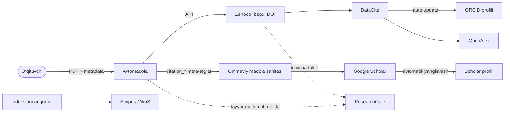
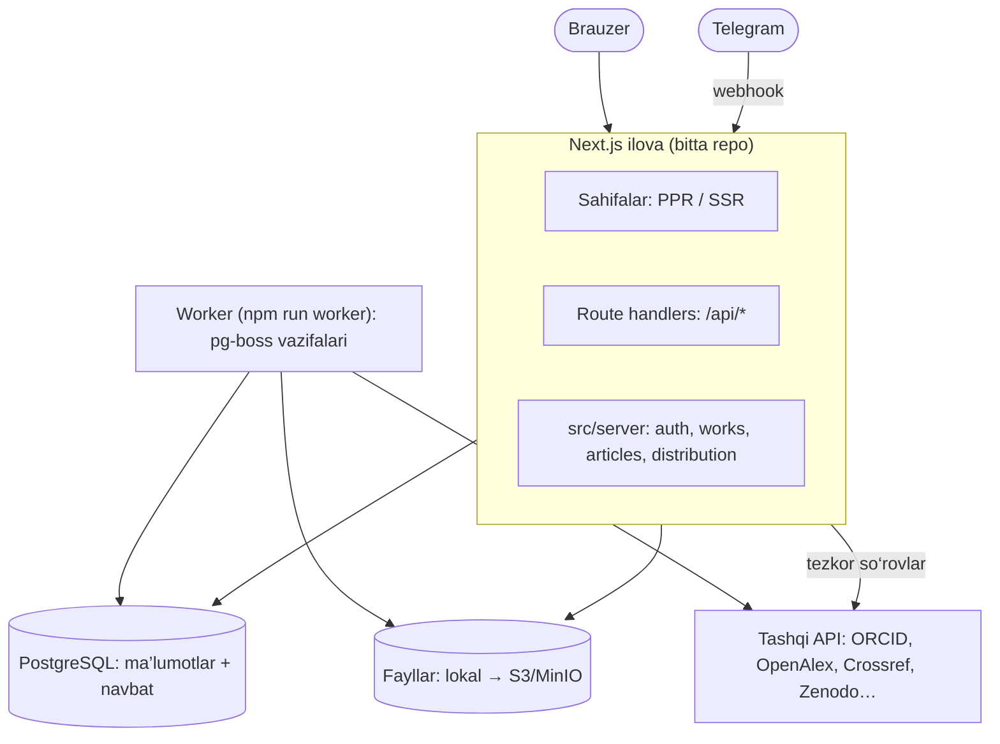
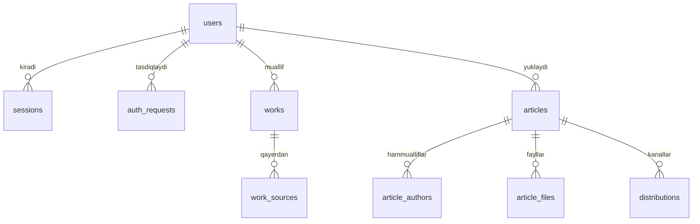
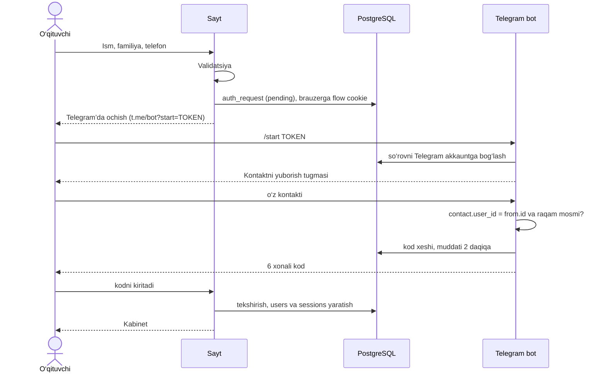
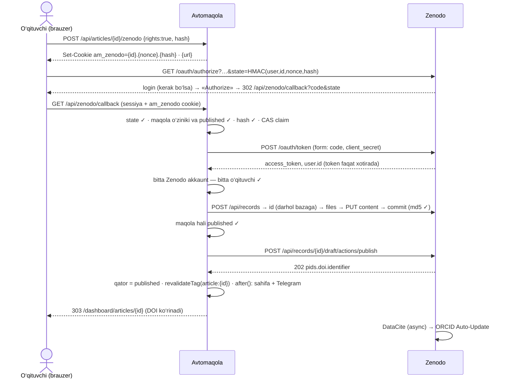

# Avtomaqola — arxitektura

> Holat: 1-bosqich (kirish/ro‘yxatdan o‘tish) tayyor. Platformalar haqidagi ma’lumotlar **2026-yil oktyabr** holatiga tekshirilgan — narxlar va limitlar o‘zgarib turadi, integratsiyani boshlashdan oldin manbadan qayta ko‘ring.

## 1. G‘oyaning mohiyati

**Muammo.** O‘qituvchi har bir maqolasini bir nechta joyga qo‘lda joylaydi, hisobot (HEMIS "Ilmiy faoliyat", reyting) uchun esa o‘z maqolalari ro‘yxatini turli saytlardan qidirib yig‘adi.

**Yechim — "yagona oyna"**, ikki yo‘nalishda:

1. **Yig‘ish (import).** ORCID iD bo‘yicha barcha maqolalarni ochiq manbalardan olib, takrorlarini birlashtirib, bitta ro‘yxatda ko‘rsatish.
2. **Tarqatish (publish).** Maqolani bir marta yuklash → API’si bor platformalarga avtomatik joylash → qolganlari uchun tayyor ma’lumot va yo‘riqnoma berish, holatini kuzatish.

### Eng muhim haqiqat: platformalar uch xil

| Turi | Misollar | Biz nima qila olamiz |
|---|---|---|
| **Repozitoriy** — fayl qabul qiladi | Zenodo, OSF Preprints, bizning sayt | API orqali to‘liq avtomatik joylash, bepul DOI olish |
| **Profil / registr** | ORCID, Google Scholar profili, ResearchGate, Scopus Author Profile | ORCID’ga yozish mumkin (pullik a’zolik yoki DataCite orqali bepul). Qolganlari o‘zi yangilanadi yoki faqat qo‘lda |
| **Indeks** — o‘zi topadi yoki o‘zi tanlaydi | Google Scholar, OpenAlex, Semantic Scholar, Scopus, Web of Science | "Post qilib" **bo‘lmaydi**. Scholar va OpenAlex DOI hamda meta-teglar orqali o‘zi topadi. Scopus/WoS faqat ular indekslaydigan jurnalda chop etilganini oladi |

**Xulosa:** "bitta tugma bilan hamma saytga post" so‘zma-so‘z mumkin emas — Scopus, Google Scholar va ResearchGate’da bunday API yo‘q. Lekin quyidagisi mumkin va aynan u ishlaydi: **maqolani bir marta to‘g‘ri joylash** (DOI + ORCID iD’li metadata + Scholar meta-teglari) — shundan keyin indekslar va profillar uni o‘zi oladi.



Google Scholar Zenodo’ni indekslamaydi ([Zenodo FAQ](https://support.zenodo.org/help/en-gb/18-general/61-is-zenodo-indexed-by-google-scholar)) — Scholar maqolani bizning sahifadagi `citation_*` teglardan oladi.

## 2. Platformalar xaritasi

| Platforma | ORCID bo‘yicha o‘qish | Dasturiy joylash | Shart / narx | Bizdagi rejasi |
|---|---|---|---|---|
| **ORCID** | Ha — Public API (anonim 25 000/kun IP’ga; bepul client 100 000/kun) | Faqat Member API + foydalanuvchi OAuth (`/activities/update`) | Yozish uchun pullik a’zolik (Basic ~US$4 775/yil, konsorsium orqali arzonroq). **Public API notijorat**: pullik xizmatda ishlatish taqiqlangan, doimiy polling ham | O‘qish; "Sign in with ORCID" (`/authenticate`, bepul) bilan egalikni tasdiqlash; ORCID’ga yozish DataCite orqali |
| **OpenAlex** | Ha — eng to‘liq manba: `/works?filter=authorships.author.orcid:{iD}` | Yo‘q (Crossref va DataCite’dan o‘zi oladi) | 2026-fevraldan API kalit kerak; bepul kalit kuniga $1 kredit (~10 000 ta ro‘yxat so‘rovi) | Asosiy import manbai |
| **Crossref** | Qisman — faqat nashriyot iD’ni kiritgan ishlar: `/works?filter=orcid:{iD}` | Faqat a’zo tashkilot DOI ro‘yxatdan o‘tkazadi | Ro‘yxat so‘rovlari 1–3 so‘rov/s. **O‘zbekiston GEM ro‘yxatida — a’zolik to‘lovlari olinmaydi** | Metadata boyitish; universitet jurnaliga bepul DOI imkoniyati |
| **DataCite** | Ha: `api.datacite.org/dois?user-id={iD}` | Zenodo orqali | Bepul | ORCID auto-update |
| **Zenodo** | Ha: `/api/records?q=creators.orcid:"{iD}"` | **Ha** — REST API, bepul DOI (`10.5281/zenodo.N`), `sandbox.zenodo.org`. Faqat o‘qituvchining o‘z akkaunti orqali (OAuth) | Bepul; yozuvga 50 GB, 100 so‘rov/daqiqa. Taqiqlangan: AI yozgan kontent, faqat annotatsiyadan iborat yozuv, ommaviy "DOI fabrikasi" | Asosiy joylash kanali (shartlari 6-bo‘limda) |
| **Google Scholar** | Rasmiy API yo‘q. SerpApi faqat Scholar ID bilan ishlaydi, pullik; Google 2025-dekabrda SerpApi’ni sudga bergan | Yo‘q — faqat crawl | Bepul | Har bir maqola uchun alohida sahifa, `citation_*` teglar, sitemap. Scraping qilmaymiz |
| **ResearchGate** | API yo‘q; scraping ToS bo‘yicha taqiqlangan | Yo‘q | — | O‘qituvchiga tayyor ma’lumot va qo‘lda qo‘shish yo‘riqnomasi |
| **Scopus** | Faqat obunachi tashkilot IP’sidan yoki `insttoken` bilan: Author Search `ORCID()` → AU-ID → hujjatlar | Yo‘q — faqat CSAB tasdiqlagan jurnallar | Obuna; notijorat foydalanish | Ixtiyoriy: universitet obunasi bo‘lsa ulaymiz |
| **Web of Science** | Starter API, `AI=` maydoni | Yo‘q | Bepul sinov 50 so‘rov/kun; ko‘prog‘i obuna | Ixtiyoriy |
| **Semantic Scholar** | ORCID bo‘yicha qidiruv yo‘q — DOI’lar bilan batch | Yo‘q | Bepul kalit, 1 so‘rov/s | Iqtiboslar bilan boyitish |
| **OSF Preprints** | — | Ha — API, moderatsiyadan o‘tadi, Crossref DOI | Bepul | 2-navbatdagi kanal |
| **arXiv** | — | Amalda yo‘q: proxy sifatida oldindan ruxsat, endorsement, oyiga 2 ta yuborish | — | Tavsiya etilmaydi |
| **HEMIS, OAK, nsp.gov.uz** | Ochiq API topilmadi | — | — | Hisobot uchun Excel/Word eksport |
| **Universitet OJS jurnallari** | OAI-PMH orqali (masalan, `journals.nuu.uz`) | — | Bepul | Mahalliy maqolalarni yig‘ish |

Manbalar: [ORCID API limitlari](https://info.orcid.org/ufaqs/what-are-the-api-limits/), [ORCID Public API shartlari](https://info.orcid.org/public-client-terms-of-service/), [OpenAlex narxlari](https://help.openalex.org/access/example-costs), [Crossref GEM](https://www.crossref.org/gem/), [Zenodo API](https://developers.zenodo.org), [Scholar inclusion](https://scholar.google.com/intl/en/scholar/inclusion.html), [DataCite va ORCID](https://support.datacite.org/docs/datacite-and-orcid), [Elsevier API](https://dev.elsevier.com/tecdoc_api_authentication.html), [WoS Starter API](https://developer.clarivate.com/apis/wos-starter).

## 3. Tizim arxitekturasi

**Modulli monolit + fon worker.** Bitta repo, bitta Next.js ilova (UI + API + Telegram webhook), va shu koddan ishga tushadigan alohida worker jarayoni. Infratuzilma — faqat PostgreSQL: navbat ham shu bazada ([pg-boss](https://github.com/timgit/pg-boss)), Redis kerak emas.



**Nega navbat?** Tashqi API’lar sekin, ishonchsiz va limitli (Crossref ro‘yxatlarga 1 so‘rov/s, OpenAlex kunlik kredit). Bular HTTP so‘rov ichida emas, fon vazifasi sifatida, backoff bilan bajariladi. Zenodo’ga joylash (1-versiya) esa navbatsiz: o‘qituvchi Zenodo’da «Authorize» bosgach, callback so‘rovining o‘zida 5–30 soniyada bajariladi; qayta urinishni o‘qituvchi bosadi (5.4).

### Modullar

| Modul | Vazifasi | Holat |
|---|---|---|
| `auth` | Telegram orqali kod, sessiyalar | ✅ tayyor |
| `telegram` | Bot: kontakt, kodlar, keyinchalik xabarnomalar | ✅ tayyor |
| `profiles` | Olim profili, rasm, ommaviy sahifa `/oqituvchi/ism-familiya` | ✅ tayyor (ORCID OAuth — 2-bosqich) |
| `works` | Import konnektorlari, dublikatlarni birlashtirish, sinxronlash | 2-bosqich |
| `articles` | Yuklash, admin tasdig‘i, ommaviy sahifa, Scholar teglari | ✅ tayyor |
| `ai` | Muharrirdagi AI yordamchi (Claude): maqolani uch tilda to‘ldirish | ✅ tayyor |
| `zenodo` | O‘qituvchining o‘z Zenodo akkaunti orqali joylash (OAuth), DOI sahifada | ✅ tayyor (sandbox sinovi kutilmoqda) |
| `distribution` | Kanal adapterlari, holat kuzatish, operator navbati | 4-bosqich |
| `admin` | ✅ `/admin`: umumiy statistika, navbat, maqolalar, o‘qituvchilar, AI so‘rovlar; operator paneli (tarqatish) — 5-bosqich | ✅ / 5-bosqich |

### Papkalar

```
src/
  app/                    # HTTP qatlam: sahifalar va /api route'lar
  lib/                    # klient+server uchun umumiy toza kod (validatsiya, tiplar)
  server/
    auth/  telegram/      # ✅
    orcid/                # ✅ iD tekshiruvi → OAuth, works
    works/connectors/     # orcid.ts, openalex.ts, crossref.ts, datacite.ts, scopus.ts
    articles/
    ai/                   # ✅ Claude: ko‘rsatma, tool-use sikli, limit va statistika
    zenodo/               # ✅ OAuth, yozuv (metama’lumot), joylash — 5.4
    distribution/channels/  # zenodo.ts, osf.ts, manual.ts
    jobs/                 # pg-boss vazifalari
  worker.ts               # alohida jarayon
```

### Kengaytirish nuqtalari (ports & adapters)

Har bir tashqi platforma bitta interfeysni amalga oshiradi. Yangi manba yoki kanal qo‘shish qolgan kodga tegmaydi.

```ts
interface WorkSource {
  id: "orcid" | "openalex" | "crossref" | "datacite" | "scopus";
  fetchByOrcid(orcid: string): Promise<NormalizedWork[]>;
}

interface PublishChannel {
  id: "zenodo" | "osf" | "orcid" | "researchgate";
  mode: "api" | "manual"; // manual — operator yoki o‘qituvchi uchun yo‘riqnoma
  publish(article: ArticleForPublishing): Promise<ChannelResult>;
  checkStatus?(externalId: string): Promise<ChannelStatus>;
}
```

## 4. Ma’lumotlar modeli

Hozir mavjud ([schema.ts](../src/server/db/schema.ts)): `users`, `auth_requests`, `sessions`, `profiles`, `articles`, `article_authors`, `ai_requests`, `zenodo_deposits`.

- **profiles** — `users` bilan 1:1, birinchi saqlashda yaratiladi. `slug` o‘zgarmaydi (havolalar buzilmasin). Telefon va Telegram ommaviy so‘rovlarda hech qachon tanlanmaydi.
- **articles** — URL `/maqola/{id}` (raqam: uch tildagi sarlavhadan slug tanlab bo‘lmaydi). Ixtiyoriy nashr ma’lumotlari (maqola jurnal yoki konferensiya to‘plamida allaqachon chiqqan bo‘lsa): `venue_type` (journal|conference), `venue`, `volume`, `issue`, `pages` (oraliq yoki maqola raqami), `pub_year`, `doi` (prefiksisiz, DB CHECK) — Scholar teglari va iqtiboslarda ishlatiladi. Uch til uchun 9 ustun (`title_/abstract_/keywords_` × `uz|ru|en`) va `lang` — PDF tili, h1 va `citation_title` shu tilda. Holatlar: `draft → submitted → published`, `rejected` (tuzatishga qaytgan yoki saytdan olib tashlangan). `published_at` birinchi chop etishda qo‘yiladi va o‘zgarmaydi. DB CHECK: yuborilgan maqolada barcha 9 matn, PDF va huquq tasdig‘i bo‘lishi shart.
- **article_authors** — mualliflar PDF’dagi tartibda (`citation_author` shu tartibda chiqadi). Faqat o‘qituvchining o‘z qatori `user_id` bilan bog‘langan, hammualliflar oddiy matn.
- **ai_requests** — AI yordamchiga har bir so‘rov: holat, tokenlar (kesh bilan), taxminiy narx (mikrodollar), davomiylik, xato kodi. Kunlik limit va admin statistikasi shundan. Suhbat matni saqlanmaydi.
- **zenodo_deposits** — maqolaning Zenodo’dagi nusxasi: kalit `(article_id, host)` — bitta Zenodo serverida bitta yozuv, sandbox va production qatorlari bir-biriga xalaqit bermaydi; `status` (in_progress, published, failed), `record_id` (qoralama yaratilishi bilan yoziladi), `doi`, `zenodo_user_id` (bitta Zenodo akkaunt — bitta o‘qituvchi), `error`. Token saqlanmaydi. `articles` qatoriga tegilmaydi. `distributions` — ikkinchi API kanal (OSF) qo‘shilganda.

Rejadagi jadvallar:



- **works** — yig‘ilgan maqola: `doi` (kichik harfda), `title`, `title_normalized`, `year`, `type`, `venue`, `authors jsonb`, `citation_count`. Unikal kalit: `(user_id, doi)`, faqat DOI bor bo‘lsa.
- **work_sources** — har bir manbadagi asl yozuv: `source`, `external_id`, `raw jsonb`, `fetched_at`. Unikal kalit: `(source, external_id)`.
- **articles.doi** — maqola boshqa joyda chop etilgan bo‘lsa, nashriyot DOI’si. Zenodo DOI’si bu yerga yozilmaydi.
- **distributions** — maqolaning har bir kanaldagi holati: `channel`, `status` (queued, in_progress, published, failed, manual_pending, manual_done), `external_id`, `external_url`, `attempts`, `last_error`. Unikal kalit: `(article_id, channel)`.

**Dublikatlarni birlashtirish** (bitta maqola ORCID, OpenAlex va Crossref’dan uch marta keladi):

1. DOI bir xil bo‘lsa (`https://doi.org/` olib tashlanib, kichik harfga o‘tkazilgan), demak bitta maqola.
2. DOI bo‘lmasa: normallashtirilgan sarlavha (harflar va raqamlar, kichik harf), yil (±1) va birinchi muallif familiyasi solishtiriladi.
3. Eng to‘liq yozuv asos qilib olinadi, har bir manba `work_sources` ga yoziladi.

## 5. Asosiy oqimlar

### 5.1 Ro‘yxatdan o‘tish va kirish ✅



Kirish (login) xuddi shunday, faqat birinchi qadamda telefon raqamning o‘zi kiritiladi.

### 5.2 "Mening maqolalarim" (2-bosqich)

1. Tugma bosiladi → `works.sync(userId)` vazifasi navbatga qo‘yiladi.
2. Worker konnektorlarni parallel chaqiradi: ORCID, OpenAlex, Crossref, DataCite; obuna bo‘lsa Scopus ham.
3. Natijalar normallashtiriladi, dublikatlar birlashtiriladi va bazaga yoziladi (upsert).
4. Sahifa natijani ko‘rsatadi; Excel’ga eksport (HEMIS hisoboti uchun).
5. Avtomatik yangilanish haftasiga bir marta. ORCID shartlari doimiy pollingni taqiqlaydi.

### 5.3 Maqola joylash va tasdiqlash ✅

1. O‘qituvchi kabinetda "Yangi maqola" → qoralama yaratiladi (`/dashboard/articles/{id}`); hech narsa yozilmagan qoralama bo‘lsa, yangisi emas, o‘sha ochiladi. Qoralama chala bo‘lishi mumkin va o‘zi saqlanadi (avtosaqlash: oxirgi o‘zgarishdan ~2,5 s keyin, bir vaqtda bitta so‘rov; holat — «Saqlanmoqda…» / «Saqlandi» / «Saqlanmadi — qayta urinish»). Barcha maqolalar — `/dashboard/articles` («Maqolalarim»), holat bo‘yicha filtr bilan.
2. Muharrir — chapda AI yordamchi (40%), o‘ngda 4 bosqich: ① maqola matni — PDF (≤10 MB, `%PDF-` imzosi tekshiriladi) ② sarlavha (va maqola tili) ③ mualliflar va tashkilotlar ④ annotatsiya va kalit so‘zlar (uch tilda); tepada bosqichlar holati. Nashr ma’lumotlari (jurnal, DOI) formada ko‘rsatilmaydi va AI ham taklif qilmaydi; ustunlar va Scholar teglari saqlanib qolgan. Litsenziya sukut bo‘yicha CC BY 4.0 (alohida bosqich yo‘q); huquq tasdig‘i — yuborishning o‘zi (`rights_confirmed_at` yuborishda yoziladi), bu ko‘rinish oynasida yuborish tugmasi yonida yozilgan. Kamchiliklar ro‘yxati klient va serverda bitta funksiyadan keladi ([article-rules.ts](../src/lib/article-rules.ts)), jumladan ruscha matn kirillda, inglizchasi lotinda bo‘lishi.
3. "Ko‘rish va yuborish" → sahifa ommaga qanday ochilishi oynada ko‘rsatiladi; o‘qituvchi **tasdiqlasa** → `submitted`, adminlarga Telegram xabari. Shundan keyin o‘qituvchi tahrirlay olmaydi. Maydonlarni AI yordamchi to‘ldirishi mumkin (5.5).
4. Admin `/admin/queue` navbatida (eng eskisi birinchi; umumiy statistika `/admin`da) maqolani ommaviy sahifa ko‘rinishida ko‘radi: **Chop etish** yoki izoh bilan **Tuzatishga qaytarish**. Chop etilganini izoh bilan **saytdan olib tashlash** mumkin. Holat compare-and-set bilan o‘zgaradi; qaror admin ko‘rgan yuborishga (`submitted_at`) bog‘langan — o‘qituvchi shu orada qayta yuborgan bo‘lsa, eski oynadan tasdiqlab bo‘lmaydi (409).
5. Chop etilgach: `/maqola/{id}` ochiladi, keshdagi teglar (`article:{id}`, `articles`, `author:{userId}`) darhol eskiradi, o‘qituvchiga Telegram xabari boradi.

Ommaviy sahifalar (`/maqola/[id]`, `/oqituvchi/[slug]`) `ensureStatic = 'navigation'`: birinchi so‘rov ham (Scholar boti ham) tayyor HTML oladi, yo‘q sahifa haqiqiy 404. `next build` bazaga murojaat qilmaydi: `generateStaticParams` o‘rinbosar qaytaradi, ro‘yxatlar va sitemap `connection()` bilan so‘rov vaqtida.

### 5.4 Tashqi tarqatish (4-bosqich)



- **Har joylashda Zenodo ruxsati** (OAuth, kalit saqlanmaydi): yuklovchi — o‘qituvchining o‘z Zenodo akkaunti (Zenodo’ga ORCID bilan kirish tavsiya etiladi). O‘qituvchi kabinetdagi Zenodo panelida yuboriladigan ma’lumotni ko‘rib, huquqini tasdiqlaydi — chop etilgan yozuvni o‘chirib bo‘lmaydi.
- **Qaysi maqola:** faqat egasi joylaydi, faqat admin chop etgan va saytda birinchi chop etilgan maqola (jurnal yoki nashriyot DOI’si bori — yo‘q). Bitta Zenodo serverida bitta yozuv; adminlar joylamaydi.
- **Yozuv** ([record.ts](../src/server/zenodo/record.ts)): `publication-preprint`, publisher "Zenodo", sana — saytda chop etilgan kun (Toshkent); sarlavha va annotatsiya PDF tilida, qolgan ikki til — tarjima sifatida; ORCID iD’lar; AI yordamchi maydon taklif qilgan bo‘lsa — AI izohi (Zenodo talabi). `pids` va `custom_fields` yuborilmaydi (ISSN IsPartOf bo‘lib, ORCID’ga avtomatik tushishni to‘sadi). Panel ko‘rsatgan yozuv xesh bilan (metama’lumot + `pdf_key`) callback’da qayta tekshiriladi.
- **Xavfsizlik:** `state` = HMAC(AUTH_SECRET; foydalanuvchi, maqola, nonce, xesh) joriy sessiya bilan timing-safe solishtiriladi. Token faqat callback so‘rovi xotirasida, refresh token tashlanadi. Har so‘rovda `User-Agent: Avtomaqola/1.0 (+APP_URL)` — zenodo.org Node’ning standart UA’siga HTML 403 qaytaradi (sandbox qaytarmaydi). Manzil faqat zenodo.org yoki sandbox.zenodo.org (testda lokal mock), `redirect: "error"`.
- **Ishonchlilik:** kod tokenga almashtirilishidan oldin bazada compare-and-set — parallel callback’lar kodni ikki marta almashtirmaydi (`?zenodo=busy`). `record_id` qoralama yaratilishi bilan yoziladi: qayta urinish chop etilganini oladi yoki qoralamani o‘chiradi — ikkinchi DOI chiqmaydi. md5 mos kelmasa yoki shu orada maqola saytdan olib tashlansa, chop etilmaydi. Bitta Zenodo akkaunti — bitta o‘qituvchi. 10 daqiqadan eski `in_progress` — uzilgan urinish. Xato sababi panelda; rejected, blocked, config va internal xatolar adminlarga Telegram’da.
- **Sahifada** faqat zenodo.org DOI’si (`10.5281/…`): DOI qatori, `citation_doi`, JSON-LD `sameAs`, APA va BibTeX. Nashriyot DOI’si bo‘lsa — u ustun. Sandbox DOI’si faqat o‘qituvchi panelida («Zenodo (sinov)»). Admin maqolani saytdan olib tashlasa, Zenodo’dagi nusxa qoladi (tasdiqlash oynasida yoziladi).
- **Testlar:** `node tests/zenodo/run.mjs` — Zenodo mock’i ([mock.mjs](../tests/zenodo/mock.mjs)) va alohida `next build` + `next start -p 3100`; dev server va boshqa ma’lumotlarga tegmaydi.
- **Onboarding sharti:** o‘qituvchi DataCite Commons’da "ORCID Auto-Update" ni **birinchi Zenodo yuklashidan oldin** yoqishi kerak — u faqat yoqilgandan keyin ro‘yxatdan o‘tgan DOI’larni ORCID’ga yuboradi.
- **Google Scholar talablari:** har bir maqola alohida URL’da; annotatsiya login’siz ko‘rinadi; PDF ≤5 MB va matn qatlami bor; teglar `citation_title`, `citation_author` (har bir muallif uchun alohida), `citation_publication_date`, `citation_pdf_url`; bosh sahifadan ko‘pi bilan 10 ta havola orqali yetib borish mumkin.
- **Qo‘lda kanallar** (ResearchGate, mahalliy jurnallar): `distributions.status = manual_pending`, o‘qituvchi yoki operatorga nusxa olishga tayyor metadata va havola ko‘rsatiladi.

### 5.5 AI yordamchi ✅

Muharrirning o‘ng tomonida (mobilda alohida oynada) chat. O‘qituvchi PDF’ni yuklaydi yoki maqola matnini chatga joylashtiradi (istalgan tilda) — model sarlavha, annotatsiya va kalit so‘zlarni o‘zbek, rus va ingliz tillarida to‘ldiradi, maqola tilini belgilaydi va mualliflar ro‘yxatini tuzadi. Taklif formaga darhol qo‘llanadi (o‘zgargan maydonlar kartada, "O‘zgarishlarni qaytarish" bilan), model esa oxirida nima qilganini va yuborishdan oldin yana nima kerakligini yozadi. Yuborishni o‘qituvchi "Ko‘rish va yuborish" oynasida o‘zi tasdiqlaydi.

- **Model:** `claude-opus-5-5`, adaptiv thinking, `effort: medium`. Server tomonida `fallbacks: "default"` (beta `server-side-fallback-2026-07-01`): xavfsizlik klassifikatori rad etsa, so‘rov tavsiya etilgan zaxira modelda bajariladi.
- **Oqim:** `POST /api/articles/{id}/ai` → NDJSON ([lib/ai.ts](../src/lib/ai.ts) `AiEvent`): holat, yozilayotgan maydon, taklif, matn, yakun. Model formani `propose_changes` vositasi (strict sxema, `eager_input_streaming`) orqali o‘zgartiradi va **avval chaqiradi, xabarni keyin yozadi**: Opus 5.5’da tool chaqiruvidan oldingi uzun matn ko‘rinmas `thinking` blokiga aylanishi mumkin, oxirgi matn esa doim oddiy matn.
- **Tool-use sikli (≤4 aylanish):** har chaqiruv serverda zod bilan tekshiriladi va forma qoidalariga moslanadi (uzunlik, takrorlar, vergulli kalit so‘zlar, o‘zbekcha ‘ va ’ belgilari, muallif ismlari, ORCID nazorat raqami). Kesilgan yoki qo‘llanmagan maydon modelga `tool_result`da aniq sabab bilan qaytadi — model keyingi aylanishda tuzatib yuboradi. Har aylanishdan keyin to‘plangan taklif darhol klientga yuboriladi. Zaxira modelga o‘tilsa, rad etilgan urinishning chala chaqiruvlari tashlanadi.
- **O‘qituvchi qatori:** `isMe` qatorining ismi va ORCID’i formadagidan olinadi; model boshqa muallifni "isMe" deb belgilasa, ro‘yxat qo‘llanmaydi (maqoladagi yashirin ko‘rsatma o‘qituvchi profilini begona ismga bog‘lay olmasin).
- **Qaytarish:** faqat hali AI qiymati turgan maydonlar qaytariladi — keyin o‘qituvchi yoki boshqa javob o‘zgartirgan maydonga tegilmaydi. Yuborish/o‘chirish paytida va ko‘rinish oynasi ochiq turganda taklif formaga tushmaydi ("Formaga qo‘llash" tugmasi qoladi); avtosaqlash formani qulflamaydi — qo‘llangan va qaytarilgan taklif ham o‘zi saqlanadi. AI yozayotganda yuborish tasdig‘i kutadi.
- **Stateless:** suhbat tarixi klientda, har so‘rovda yuboriladi (birinchi juftlik + oxirgi 5 ta). Formaning joriy (saqlanmagan) holati va yuborishdan oldin yetishmayotganlar (PDF, profil) oxirgi xabarda. Kesh: tizim ko‘rsatmasi, PDF + birinchi xabar va oxirgi xabar — keyingi aylanish va xabarlar keshdan (0,05× narx) o‘qiladi.
- **Limitlar:** bir o‘qituvchiga kuniga 30 so‘rov va $5 (Toshkent vaqti), bir vaqtda bitta javob (advisory lock), bitta so‘rov ≤4 daqiqa; PDF ≤150 000 token (taxminan 50 sahifa) — kattasi yoki ochilmaydigani (buzuq, parolli) modelga yuborilmaydi, model matnni chatga joylashtirishni so‘raydi; xabar ≤100 000 belgi, butun suhbat ≤150 000, model javobi tarixda ≤8 000, javob ≤32 000 token. Limit va PDF tekshiruvi qimmat ishdan oldin. Sahifadan chiqilsa yoki "To‘xtatish" bosilsa, model ham to‘xtaydi.
- **Narx (o‘lchangan):** to‘liq to‘ldirish ~$0,10 va ~35–40 s; kichik tuzatish ~$0,02–0,04 va ~10 s. To‘xtatilgan so‘rovning chiqish tokenlari to‘liq hisobga tushmaydi (taxminiy narx biroz kam).
- **Xavfsizlik:** model faqat o‘qituvchining o‘z formasiga taklif beradi (serverda hech narsa yozmaydi), litsenziya va huquq tasdig‘iga tegmaydi; hamma narsa saqlashda `draftSchema`, yuborishda `articleProblems` va admin tomonidan qayta tekshiriladi. Maqola matnidagi ko‘rsatmalar ma’lumot sifatida qaraladi. Matn va PDF tahlil uchun Anthropic’ga yuboriladi — bu panelda doim yozilgan. Suhbat matni saqlanmaydi, faqat statistika (`ai_requests`).

## 6. Qarorlar va cheklovlar

- **Monolit + worker**, mikroservis emas: kichik jamoa, bitta deploy.
- **Drizzle ORM**: sxema TypeScript’da, SQL’ga yaqin, kod generatsiyasi yo‘q.
- **Telegram orqali kod**: SMS-provayder xarajati yo‘q, Telegram O‘zbekistonda keng tarqalgan. Kanal almashtiriladigan qilib yozilgan — kerak bo‘lsa SMS (masalan, Eskiz) qo‘shiladi.
- **ORCID iD profil tahririda qo‘lda kiritiladi** (ro‘yxatdan o‘tishda so‘ralmaydi), ya’ni "tasdiqlanmagan" (`users.orcid_verified_at`). Nazorat raqami va iD mavjudligi tekshiriladi, lekin birov boshqa odamning iD’sini yozishi mumkin. Zenodo’ga tarqatish hozircha tasdiqlanmagan iD bilan ham ochiq: admin mualliflar va ORCID’larni PDF bilan solishtiradi; "Sign in with ORCID" (`/authenticate` — bepul) qurilgach, shart kuchaytiriladi.
- **Mualliflik huquqi:** jurnalda allaqachon chop etilgan maqolani Zenodo’ga qayta yuklash nashriyot siyosatiga bog‘liq. Yuklashda o‘qituvchi huquqini tasdiqlaydi. Chop etilgan maqola uchun "faqat annotatsiya + jurnal DOI havolasi" rejimi **faqat bizning saytda** bo‘ladi, chunki Zenodo faqat annotatsiyadan iborat yozuvni qabul qilmaydi.
- **Zenodo qoidalari** (2026-oktyabrda tekshirilgan):
  - **Javobgarlik:** yuklovchi o‘z kontenti uchun to‘liq javobgar.
  - **Mos emas deb belgilangan kontent:** inson tadqiqotiga asoslanmagan AI kontent (siyosat 2026-yil 27-aprel), faqat annotatsiyadan iborat yozuvlar, talabalar topshiriqlari va *"DOI to‘lovidan qochish uchun nashriyotning ommaviy yuklashi"*. 2026-yilda bitta akkauntning 850 dan ortiq yozuvi ogohlantirishsiz o‘chirilgan.
  - **Shuning uchun:** barcha maqolani bitta platforma akkauntidan **yuklamaymiz** — har bir o‘qituvchi o‘z akkaunti orqali, OAuth bilan yuklaydi. Yuklashdan oldin sifat nazorati bo‘ladi: o‘qituvchi huquqini tasdiqlaydi, AI ishlatgan bo‘lsa ochiq aytadi, operator ko‘rib chiqadi.
  - **Ko‘p DOI kerak bo‘lsa** (universitet jurnali, to‘plamlar), Zenodo emas, universitetning Crossref a’zoligi kerak.
  - Manbalar: [shartlar](https://about.zenodo.org/terms/), [siyosatlar](https://about.zenodo.org/policies/), [mos bo‘lmagan kontent](https://support.zenodo.org/help/en-gb/2-content/141-what-content-is-not-suitable-for-zenodo), [GitHub #2606](https://github.com/zenodo/zenodo/issues/2606).
- **Litsenziyalar:** ORCID Public API va Scopus API notijorat. Xizmat pullik bo‘lsa, ORCID a’zoligi (universitet nomidan yoki konsorsium orqali) kerak.
- Google Scholar va ResearchGate **scraping qilinmaydi** (ToS, huquqiy xavf).

## 7. Xavfsizlik (amalga oshirilgan)

- **Kod:** 6 xonali, 2 daqiqa amal qiladi. Bazada server kaliti bilan HMAC-SHA256 ko‘rinishida saqlanadi — oddiy xesh 10⁶ variant uchun befoyda bo‘lardi. Bitta kodga 5 urinish, bitta oqimga 3 ta kod, qayta yuborish oralig‘i 30 soniya.
- **Telegram:** faqat o‘z kontakti qabul qilinadi (`contact.user_id === from.id`) va raqami solishtiriladi. Webhook `X-Telegram-Bot-Api-Secret-Token` sarlavhasi bilan timing-safe tekshiriladi.
- **Tanish akkaunt:** kirishda «Kodni olish» havolasini ro‘yxatdan o‘tishda bog‘langan Telegram akkaunt bossa, kontakt so‘ralmasdan kod darhol yuboriladi; qayta bosish — 30 soniya oraliq va 3 ta kod limiti bilan yangi kod. Havolasiz `/start` kod bermaydi (aks holda firibgar o‘zi boshlagan kirish kodini "botda Start bosing" deb so‘rab olardi). Kod faqat jarayon hali ham so‘ragan akkauntga bog‘langan bo‘lsa chiqariladi — shart atomik UPDATE ichida.
- **Tokenlar:** brauzerda flow token (httpOnly cookie, faqat `/api/auth` uchun), Telegram havolasida undan HMAC orqali hosil qilingan start token. Bazada ikkalasi ham faqat sha256 xesh ko‘rinishida.
- **Sessiya:** access token `{sessionId}.{muddat}.{HMAC}` (15 daqiqa) + refresh token `{sessionId}.{tasodifiy}.{HMAC}` (bazada faqat xeshi). Kirishdan 7 kun o‘tgach qayta kirish so‘raladi (faollik uzaytirmaydi).
  - Yangilash `src/proxy.ts`da, faqat sessiya kerak bo‘lgan yo‘llarda (`/dashboard`, `/admin`, `/api`, `/login`, `/register`): ommaviy keshlanadigan sahifalarga token yozilmaydi; token yozilgan javob `no-store`.
  - Har yangilashda refresh token almashadi; keyingisi oldingisidan HMAC bilan aniqlanadi — 60 soniya ichida oldingi token kelsa (bir nechta tab, yo‘qolgan javob) aynan joriy token qayta beriladi. Shu sessiyaning boshqa har qanday eskirgan tokeni kelsa — o‘g‘irlik: sessiya o‘chiriladi.
  - Foydalanuvchi o‘qilganda sessiya qatori har safar tekshiriladi: chiqish darhol ishlaydi. Production’da cookie nomlari `__Host-` prefiksli (boshqa subdomen almashtira olmaydi). httpOnly, SameSite=Lax, Secure.
- **Limitlar:** telefon raqamga soatiga 5 ta, IP’ga 30 ta oqim. Qo‘shimcha CSRF himoyasi — Origin tekshiruvi.
- **Ataylab qoldirilgan:** login sahifasi raqam ro‘yxatdan o‘tgan-o‘tmaganini aytadi (qulaylik uchun).
- **Ma’lum cheklov:** limit faqat yaratilgan oqimlarni sanaydi, band raqam bilan qilingan urinishlar hisobga olinmaydi. Production’dan oldin barcha urinishlarni IP bo‘yicha sanaydigan umumiy limit kerak (alohida jadval yoki reverse-proxy darajasida).
- **Ochiq qaror:** login paytida Telegram akkaunt boshqacha bo‘lsa (raqam qayta sotilgan bo‘lishi mumkin) — [telegram-policy.ts](../src/server/auth/telegram-policy.ts).
- **Fayllar:** `public/` da emas, `STORAGE_DIR` da; faqat ruxsatni tekshiradigan route’lar orqali beriladi. Tasdiqlanmagan maqola PDF’i faqat muallif va adminga (`private, no-store`), boshqalarga 404 (borligi ham oshkor qilinmaydi). Fayl nomi `^[\w.-]+$` (yo‘l kesib o‘tish yo‘q). PDF kengaytma bo‘yicha emas, `%PDF-` imzosi bo‘yicha tekshiriladi; rasm sharp bilan qayta kodlanadi (EXIF/GPS o‘chadi).
- **So‘rov hajmi:** JSON ≤64 KB, yuklashlar ≤10 MB; `Content-Length`’siz (chunked) tana rad etiladi — aks holda `request.json()`/`formData()` cheksiz tanani xotiraga yig‘ardi.
- **Ommaviy profil moderatsiyasiz ochiladi**, shuning uchun foydalanuvchi kiritgan tashqi havolalar `rel="ugc nofollow"`, Google Scholar havolasi faqat Google domenlaridan. Maqola matnidan bidi (yo‘nalish almashtiruvchi) va ko‘rinmas belgilar olib tashlanadi.
- **Navbatni to‘ldirib tashlash:** bitta akkauntda chop etilmagan maqolalar (qoralama, navbatdagi, tuzatishdagi) ko‘pi bilan 10 ta; parallel so‘rovlar advisory lock bilan navbatma-navbat sanaladi.
- **Maxfiylik:** hech qachon yuborilmagan qoralamani (va PDF’ini) faqat muallif ko‘radi, admin ham emas. Profil yopilsa, rasm havolasi ham 404 bo‘ladi (egasidan tashqari). Tasdiqlanmagan ORCID iD JSON-LD’ga chiqmaydi.
- **Poyga holatlari:** yuborishda maqola qatori qulflanadi (`FOR UPDATE`) — tekshirilgan nusxa aynan yuborilgani bo‘ladi. O‘zgarishdan keyin muallifning ommaviy sahifalari darhol qayta yaratiladi ([warm.ts](../src/server/warm.ts)): kesh teglari xotirada, server qayta ishga tushsa eski nusxa qaytib chiqmasin.

## 7.1 Deploy talablari

- **`APP_URL`** — saytning tashqi manzili, build va server uchun majburiy (bo‘lmasa build to‘xtaydi). `robots.txt` build paytida statik yoziladi, canonical va `citation_pdf_url` ham shundan.
- **`STORAGE_DIR`** — doimiy (deploy’da o‘chmaydigan) absolyut papka: profil rasmlari va PDF’lar.
- **Bitta server jarayoni.** Kesh teglari jarayon xotirasida, ISR sahifalar va fayllar lokal diskda. Bir nechta nusxa kerak bo‘lsa — umumiy `cacheHandler` va obyekt ombori (S3) kerak.
- **nginx:** `client_max_body_size 11m;` va `proxy_set_header X-Real-IP $remote_addr;` (IP bo‘yicha limitlar shu sarlavhaga tayanadi — `X-Forwarded-For`ning birinchi qiymatini mijoz soxtalashtira oladi). Mavjud bo‘lmagan `/maqola/N` va `/oqituvchi/x` manzillari ham 404 sifatida diskka keshlanadi — botlar uchun `limit_req` qo‘ying.
- **Administrator:** foydalanuvchi saytda ro‘yxatdan o‘tgach, `npm run admin -- +998901234567`. Yangi maqolalar haqida Telegram xabari adminlarga boradi.
- **AI yordamchi:** `ANTHROPIC_API_KEY` (lokal `.env.local`da `CLAUDE-API-KEY` nomi ham o‘qiladi; systemd/shell defisli nomni qabul qilmaydi). Kalit bo‘lmasa panel ko‘rinmaydi. Javob oqim bo‘lib keladi: server `X-Accel-Buffering: no` qo‘yadi, nginx’da `/api/articles/` uchun `proxy_read_timeout 300s;` (model uzoq o‘ylaganda server har 15 soniyada bo‘sh qator yuboradi).
- **Zenodo:** `ZENODO_URL` (`https://sandbox.zenodo.org` yoki `https://zenodo.org`, boshqasi qabul qilinmaydi), `ZENODO_CLIENT_ID`, `ZENODO_CLIENT_SECRET` — uchalasi bo‘lmasa panel ko‘rinmaydi, chop etilgan DOI’lar sahifada qoladi. Har Zenodo serveri uchun alohida OAuth ilova (Confidential, Redirect URI `{APP_URL}/api/zenodo/callback`); sandbox’dan production’ga o‘tish — faqat shu uch o‘zgaruvchi (qatorlar `host` bo‘yicha alohida). Callback sinxron, eng yomoni ~7 daqiqa: nginx’da `location /api/zenodo/ { proxy_read_timeout 420s; }`. Production’dan oldin support@zenodo.org’ga integratsiyani tasvirlab yozish shart. Secret sizib chiqsa — Zenodo’da «Reset client secret»; suiiste’mol bo‘lsa — OAuth ilovani o‘chirish (barcha tokenlari bilan).

## 8. Bosqichlar

1. ✅ Telegram orqali kirish, bosh sahifa, kabinet karkasi.
2. ORCID OAuth tasdiqlash; "Mening maqolalarim" (ORCID + OpenAlex + Crossref + DataCite), dublikatlarni birlashtirish, pg-boss worker, Excel eksport.
3. ✅ Olim profili va rasmi; maqola yuklash va admin tasdig‘i; ommaviy sahifa `/maqola/[id]`, `/maqolalar`, `citation_*` teglar, JSON-LD, `sitemap.xml`, `robots.txt`; fayl ombori.
4. Zenodo (avval sandbox), DOI’ni sahifaga yozish, DataCite auto-update yo‘riqnomasi, Telegram xabarnomalari; OSF Preprints.
5. Operator paneli: qo‘lda kanallar, holatlar, hisobotlar; universitet obunasi bo‘lsa Scopus/WoS.

## 9. Ochiq savollar

1. Xizmat bepulmi yoki pullik? Bu ORCID va Scopus API litsenziyasiga bevosita ta’sir qiladi.
2. Universitet ORCID a’zosimi? CSTI (Ilmiy-texnik axborot markazi) 2025-yilda ORCID’dan O‘zbekistonda ORCID joriy etish uchun grant olgan — konsorsium imkoniyatini so‘rash kerak.
3. Universitetda Scopus yoki Web of Science obunasi bormi (API kalit va IP diapazoni)?
4. Sayt universitet domenida bo‘ladimi (masalan, `repository.<univ>.uz`)? Scholar uchun bu ishonchliroq.
5. Qanday maqolalar yuklanadi: yangi qo‘lyozmami (preprint) yoki allaqachon chop etilganmi (postprint)?
6. Universitetning OJS’dagi o‘z jurnali bormi? Crossref GEM orqali DOI’ni bepul olish mumkin.
7. HEMIS hisobotiga qanday formatda eksport kerak?
