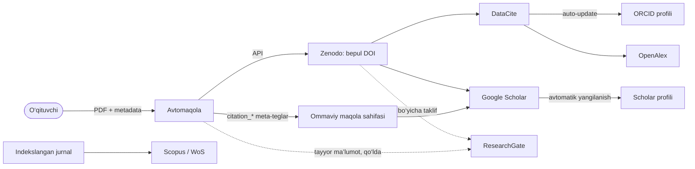
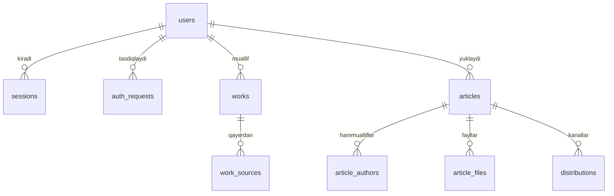
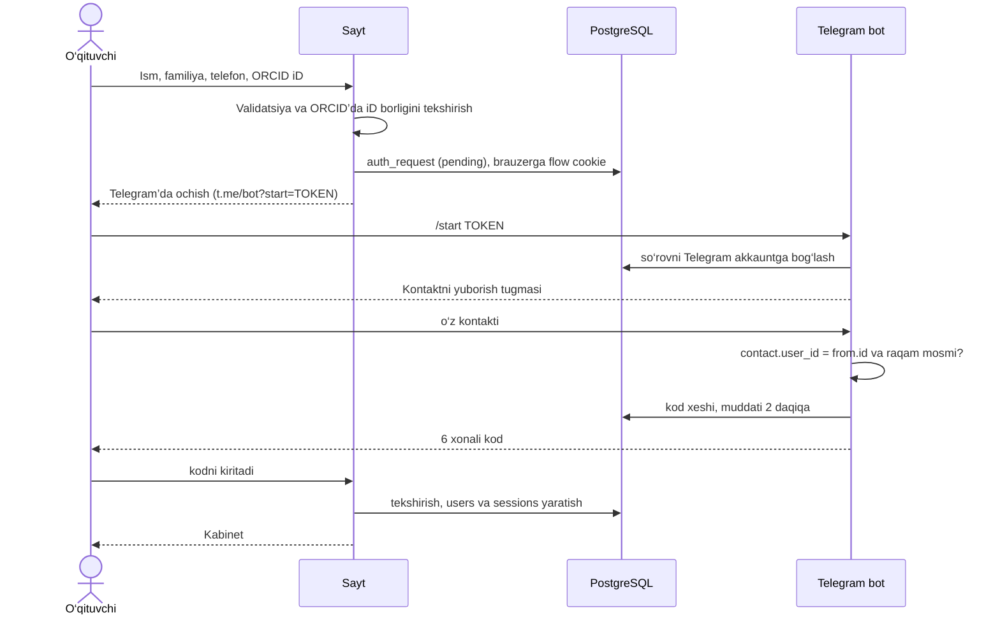
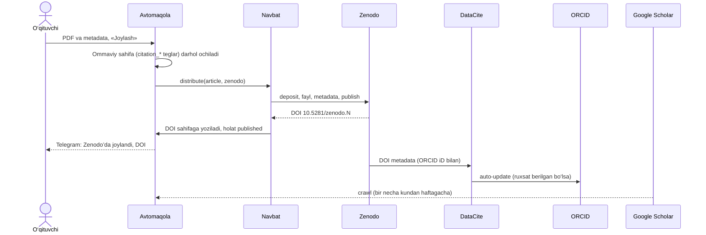

# Avtomaqola — arxitektura

> Holat: 1-bosqich (kirish/ro‘yxatdan o‘tish) tayyor. Platformalar haqidagi ma’lumotlar **2026-yil oktyabr** holatiga tekshirilgan — narxlar va limitlar o‘zgarib turadi, integratsiyani boshlashdan oldin manbadan qayta ko‘ring.

## 1. G‘oyaning mohiyati

**Muammo.** O‘qituvchi har bir maqolasini bir nechta joyga qo‘lda joylaydi, hisobot (HEMIS "Ilmiy faoliyat", reyting) uchun esa o‘z maqolalari ro‘yxatini turli saytlardan qidirib yig‘adi.

**Yechim — "yagona oyna"**, ikki yo‘nalishda:

1. **Yig‘ish (import).** ORCID iD bo‘yicha barcha maqolalarni ochiq manbalardan olib, takrorlarini birlashtirib, bitta ro‘yxatda ko‘rsatish.
2. **Tarqatish (publish).** Maqolani bir marta yuklash → API’si bor platformalarga avtomatik joylash → qolganlari uchun tayyor ma’lumot va yo‘riqnoma berish, holatini kuzatish.

### Eng muhim haqiqat: platformalar uch xil

| Turi | Misollar | Biz nima qila olamiz |
|---|---|---|
| **Repozitoriy** — fayl qabul qiladi | Zenodo, OSF Preprints, bizning sayt | API orqali to‘liq avtomatik joylash, bepul DOI olish |
| **Profil / registr** | ORCID, Google Scholar profili, ResearchGate, Scopus Author Profile | ORCID’ga yozish mumkin (pullik a’zolik yoki DataCite orqali bepul). Qolganlari o‘zi yangilanadi yoki faqat qo‘lda |
| **Indeks** — o‘zi topadi yoki o‘zi tanlaydi | Google Scholar, OpenAlex, Semantic Scholar, Scopus, Web of Science | "Post qilib" **bo‘lmaydi**. Scholar va OpenAlex DOI hamda meta-teglar orqali o‘zi topadi. Scopus/WoS faqat ular indekslaydigan jurnalda chop etilganini oladi |

**Xulosa:** "bitta tugma bilan hamma saytga post" so‘zma-so‘z mumkin emas — Scopus, Google Scholar va ResearchGate’da bunday API yo‘q. Lekin quyidagisi mumkin va aynan u ishlaydi: **maqolani bir marta to‘g‘ri joylash** (DOI + ORCID iD’li metadata + Scholar meta-teglari) — shundan keyin indekslar va profillar uni o‘zi oladi.



## 2. Platformalar xaritasi

| Platforma | ORCID bo‘yicha o‘qish | Dasturiy joylash | Shart / narx | Bizdagi rejasi |
|---|---|---|---|---|
| **ORCID** | Ha — Public API (anonim 25 000/kun IP’ga; bepul client 100 000/kun) | Faqat Member API + foydalanuvchi OAuth (`/activities/update`) | Yozish uchun pullik a’zolik (Basic ~US$4 775/yil, konsorsium orqali arzonroq). **Public API notijorat**: pullik xizmatda ishlatish taqiqlangan, doimiy polling ham | O‘qish; "Sign in with ORCID" (`/authenticate`, bepul) bilan egalikni tasdiqlash; ORCID’ga yozish DataCite orqali |
| **OpenAlex** | Ha — eng to‘liq manba: `/works?filter=authorships.author.orcid:{iD}` | Yo‘q (Crossref va DataCite’dan o‘zi oladi) | 2026-fevraldan API kalit kerak; bepul kalit kuniga $1 kredit (~10 000 ta ro‘yxat so‘rovi) | Asosiy import manbai |
| **Crossref** | Qisman — faqat nashriyot iD’ni kiritgan ishlar: `/works?filter=orcid:{iD}` | Faqat a’zo tashkilot DOI ro‘yxatdan o‘tkazadi | Ro‘yxat so‘rovlari 1–3 so‘rov/s. **O‘zbekiston GEM ro‘yxatida — a’zolik to‘lovlari olinmaydi** | Metadata boyitish; universitet jurnaliga bepul DOI imkoniyati |
| **DataCite** | Ha: `api.datacite.org/dois?user-id={iD}` | Zenodo orqali | Bepul | ORCID auto-update |
| **Zenodo** | Ha: `/api/records?q=creators.orcid:"{iD}"` | **Ha** — REST API, bepul DOI (`10.5281/zenodo.N`), `sandbox.zenodo.org` | Bepul; legacy API’da fayl ≤100 MB, 100 so‘rov/daqiqa | Asosiy joylash kanali |
| **Google Scholar** | Rasmiy API yo‘q. SerpApi faqat Scholar ID bilan ishlaydi, pullik; Google 2025-dekabrda SerpApi’ni sudga bergan | Yo‘q — faqat crawl | Bepul | Har bir maqola uchun alohida sahifa, `citation_*` teglar, sitemap. Scraping qilmaymiz |
| **ResearchGate** | API yo‘q; scraping ToS bo‘yicha taqiqlangan | Yo‘q | — | O‘qituvchiga tayyor ma’lumot va qo‘lda qo‘shish yo‘riqnomasi |
| **Scopus** | Faqat obunachi tashkilot IP’sidan yoki `insttoken` bilan: Author Search `ORCID()` → AU-ID → hujjatlar | Yo‘q — faqat CSAB tasdiqlagan jurnallar | Obuna; notijorat foydalanish | Ixtiyoriy: universitet obunasi bo‘lsa ulaymiz |
| **Web of Science** | Starter API, `AI=` maydoni | Yo‘q | Bepul sinov 50 so‘rov/kun; ko‘prog‘i obuna | Ixtiyoriy |
| **Semantic Scholar** | ORCID bo‘yicha qidiruv yo‘q — DOI’lar bilan batch | Yo‘q | Bepul kalit, 1 so‘rov/s | Iqtiboslar bilan boyitish |
| **OSF Preprints** | — | Ha — API, moderatsiyadan o‘tadi, Crossref DOI | Bepul | 2-navbatdagi kanal |
| **arXiv** | — | Amalda yo‘q: proxy sifatida oldindan ruxsat, endorsement, oyiga 2 ta yuborish | — | Tavsiya etilmaydi |
| **HEMIS, OAK, nsp.gov.uz** | Ochiq API topilmadi | — | — | Hisobot uchun Excel/Word eksport |
| **Universitet OJS jurnallari** | OAI-PMH orqali (masalan, `journals.nuu.uz`) | — | Bepul | Mahalliy maqolalarni yig‘ish |

Manbalar: [ORCID API limitlari](https://info.orcid.org/ufaqs/what-are-the-api-limits/), [ORCID Public API shartlari](https://info.orcid.org/public-client-terms-of-service/), [OpenAlex narxlari](https://help.openalex.org/access/example-costs), [Crossref GEM](https://www.crossref.org/gem/), [Zenodo API](https://developers.zenodo.org), [Scholar inclusion](https://scholar.google.com/intl/en/scholar/inclusion.html), [DataCite va ORCID](https://support.datacite.org/docs/datacite-and-orcid), [Elsevier API](https://dev.elsevier.com/tecdoc_api_authentication.html), [WoS Starter API](https://developer.clarivate.com/apis/wos-starter).

## 3. Tizim arxitekturasi

**Modulli monolit + fon worker.** Bitta repo, bitta Next.js ilova (UI + API + Telegram webhook), va shu koddan ishga tushadigan alohida worker jarayoni. Infratuzilma — faqat PostgreSQL: navbat ham shu bazada ([pg-boss](https://github.com/timgit/pg-boss)), Redis kerak emas.


**Nega navbat?** Tashqi API’lar sekin, ishonchsiz va limitli (Crossref ro‘yxatlarga 1 so‘rov/s, OpenAlex kunlik kredit). Zenodo’ga joylash bir necha qadamdan iborat va qayta urinish talab qiladi. Bular HTTP so‘rov ichida emas, fon vazifasi sifatida, backoff bilan bajariladi.

### Modullar

| Modul | Vazifasi | Holat |
|---|---|---|
| `auth` | Telegram orqali kod, sessiyalar | ✅ tayyor |
| `telegram` | Bot: kontakt, kodlar, keyinchalik xabarnomalar | ✅ tayyor |
| `researchers` | Profil, ORCID OAuth bilan egalikni tasdiqlash | 2-bosqich |
| `works` | Import konnektorlari, dublikatlarni birlashtirish, sinxronlash | 2-bosqich |
| `articles` | Yuklash, metadata, ommaviy sahifa, Scholar teglari | 3-bosqich |
| `distribution` | Kanal adapterlari, holat kuzatish, operator navbati | 4-bosqich |
| `admin` | Operator paneli, hisobotlar | 5-bosqich |

### Papkalar

```
src/
  app/                    # HTTP qatlam: sahifalar va /api route'lar
  lib/                    # klient+server uchun umumiy toza kod (validatsiya, tiplar)
  server/
    auth/  telegram/      # ✅
    orcid/                # ✅ iD tekshiruvi → OAuth, works
    works/connectors/     # orcid.ts, openalex.ts, crossref.ts, datacite.ts, scopus.ts
    articles/
    distribution/channels/  # zenodo.ts, osf.ts, manual.ts
    jobs/                 # pg-boss vazifalari
  worker.ts               # alohida jarayon
```

### Kengaytirish nuqtalari (ports & adapters)

Har bir tashqi platforma bitta interfeysni amalga oshiradi. Yangi manba yoki kanal qo‘shish qolgan kodga tegmaydi.

```ts
interface WorkSource {
  id: "orcid" | "openalex" | "crossref" | "datacite" | "scopus";
  fetchByOrcid(orcid: string): Promise<NormalizedWork[]>;
}

interface PublishChannel {
  id: "zenodo" | "osf" | "orcid" | "researchgate";
  mode: "api" | "manual"; // manual — operator yoki o‘qituvchi uchun yo‘riqnoma
  publish(article: ArticleForPublishing): Promise<ChannelResult>;
  checkStatus?(externalId: string): Promise<ChannelStatus>;
}
```

## 4. Ma’lumotlar modeli

Hozir mavjud: `users`, `auth_requests`, `sessions` ([schema.ts](../src/server/db/schema.ts)). Rejadagi jadvallar:



- **works** — yig‘ilgan maqola: `doi` (kichik harfda), `title`, `title_normalized`, `year`, `type`, `venue`, `authors jsonb`, `citation_count`. Unikal kalit: `(user_id, doi)`, faqat DOI bor bo‘lsa.
- **work_sources** — har bir manbadagi asl yozuv: `source`, `external_id`, `raw jsonb`, `fetched_at`. Unikal kalit: `(source, external_id)`.
- **articles** — o‘qituvchi yuklagan maqola: `title`, `abstract`, `keywords text[]`, `language`, `license`, `status` (draft → submitted → published), `slug`, `doi`.
- **distributions** — maqolaning har bir kanaldagi holati: `channel`, `status` (queued, in_progress, published, failed, manual_pending, manual_done), `external_id`, `external_url`, `attempts`, `last_error`. Unikal kalit: `(article_id, channel)`.

**Dublikatlarni birlashtirish** (bitta maqola ORCID, OpenAlex va Crossref’dan uch marta keladi):

1. DOI bir xil bo‘lsa (`https://doi.org/` olib tashlanib, kichik harfga o‘tkazilgan), demak bitta maqola.
2. DOI bo‘lmasa: normallashtirilgan sarlavha (harflar va raqamlar, kichik harf), yil (±1) va birinchi muallif familiyasi solishtiriladi.
3. Eng to‘liq yozuv asos qilib olinadi, har bir manba `work_sources` ga yoziladi.

## 5. Asosiy oqimlar

### 5.1 Ro‘yxatdan o‘tish va kirish ✅



Kirish (login) xuddi shunday, faqat birinchi qadamda telefon raqamning o‘zi kiritiladi.

### 5.2 "Mening maqolalarim" (2-bosqich)

1. Tugma bosiladi → `works.sync(userId)` vazifasi navbatga qo‘yiladi.
2. Worker konnektorlarni parallel chaqiradi: ORCID, OpenAlex, Crossref, DataCite; obuna bo‘lsa Scopus ham.
3. Natijalar normallashtiriladi, dublikatlar birlashtiriladi va bazaga yoziladi (upsert).
4. Sahifa natijani ko‘rsatadi; Excel’ga eksport (HEMIS hisoboti uchun).
5. Avtomatik yangilanish haftasiga bir marta. ORCID shartlari doimiy pollingni taqiqlaydi.

### 5.3 Maqola joylash (3–4-bosqich)



- **Onboarding sharti:** o‘qituvchi DataCite Commons’da "ORCID Auto-Update" ni **birinchi Zenodo yuklashidan oldin** yoqishi kerak — u faqat yoqilgandan keyin ro‘yxatdan o‘tgan DOI’larni ORCID’ga yuboradi.
- **Google Scholar talablari:** har bir maqola alohida URL’da; annotatsiya login’siz ko‘rinadi; PDF ≤5 MB va matn qatlami bor; teglar `citation_title`, `citation_author` (har bir muallif uchun alohida), `citation_publication_date`, `citation_pdf_url`; bosh sahifadan ko‘pi bilan 10 ta havola orqali yetib borish mumkin.
- **Qo‘lda kanallar** (ResearchGate, mahalliy jurnallar): `distributions.status = manual_pending`, o‘qituvchi yoki operatorga nusxa olishga tayyor metadata va havola ko‘rsatiladi.

## 6. Qarorlar va cheklovlar

- **Monolit + worker**, mikroservis emas: kichik jamoa, bitta deploy.
- **Drizzle ORM**: sxema TypeScript’da, SQL’ga yaqin, kod generatsiyasi yo‘q.
- **Telegram orqali kod**: SMS-provayder xarajati yo‘q, Telegram O‘zbekistonda keng tarqalgan. Kanal almashtiriladigan qilib yozilgan — kerak bo‘lsa SMS (masalan, Eskiz) qo‘shiladi.
- **ORCID hozircha qo‘lda kiritiladi**, ya’ni "tasdiqlanmagan" (`users.orcid_verified_at`). Nazorat raqami va iD mavjudligi tekshiriladi, lekin birov boshqa odamning iD’sini yozishi mumkin. 2-bosqichda "Sign in with ORCID" (`/authenticate` — bepul) qo‘shiladi va tarqatish faqat tasdiqlangan iD uchun ochiladi.
- **Mualliflik huquqi:** jurnalda allaqachon chop etilgan maqolani Zenodo’ga qayta yuklash nashriyot siyosatiga bog‘liq. Yuklashda o‘qituvchi huquqini tasdiqlaydi. Chop etilgan maqola uchun "faqat metadata + jurnal DOI havolasi" rejimi bo‘ladi.
- **Litsenziyalar:** ORCID Public API va Scopus API notijorat. Xizmat pullik bo‘lsa, ORCID a’zoligi (universitet nomidan yoki konsorsium orqali) kerak.
- Google Scholar va ResearchGate **scraping qilinmaydi** (ToS, huquqiy xavf).

## 7. Xavfsizlik (amalga oshirilgan)

- **Kod:** 6 xonali, 2 daqiqa amal qiladi. Bazada server kaliti bilan HMAC-SHA256 ko‘rinishida saqlanadi — oddiy xesh 10⁶ variant uchun befoyda bo‘lardi. Bitta kodga 5 urinish, bitta oqimga 3 ta kod, qayta yuborish oralig‘i 30 soniya.
- **Telegram:** faqat o‘z kontakti qabul qilinadi (`contact.user_id === from.id`) va raqami solishtiriladi. Webhook `X-Telegram-Bot-Api-Secret-Token` sarlavhasi bilan timing-safe tekshiriladi.
- **Tokenlar:** brauzerda flow token (httpOnly cookie, faqat `/api/auth` uchun), Telegram havolasida undan HMAC orqali hosil qilingan start token. Bazada ikkalasi ham faqat sha256 xesh ko‘rinishida.
- **Sessiya:** httpOnly, SameSite=Lax, production’da Secure, 30 kun. Bazada xesh saqlanadi, shuning uchun sessiyani o‘chirib bekor qilish mumkin.
- **Limitlar:** telefon raqamga soatiga 5 ta, IP’ga 30 ta oqim. Qo‘shimcha CSRF himoyasi — Origin tekshiruvi.
- **Ataylab qoldirilgan:** login sahifasi raqam ro‘yxatdan o‘tgan-o‘tmaganini aytadi (qulaylik uchun).
- **Ma’lum cheklov:** limit faqat yaratilgan oqimlarni sanaydi. ORCID tekshiruvidan o‘tmagan yoki band raqamli urinishlar hisobga olinmaydi, shuning uchun kimdir server orqali ORCID kvotasini (IP’ga 25 000/kun) sarflab yuborishi mumkin. Production’dan oldin barcha urinishlarni IP bo‘yicha sanaydigan umumiy limit kerak (alohida jadval yoki reverse-proxy darajasida).
- **Ochiq qaror:** login paytida Telegram akkaunt boshqacha bo‘lsa (raqam qayta sotilgan bo‘lishi mumkin) — [telegram-policy.ts](../src/server/auth/telegram-policy.ts).

## 8. Bosqichlar

1. ✅ Telegram orqali kirish, bosh sahifa, kabinet karkasi.
2. ORCID OAuth tasdiqlash; "Mening maqolalarim" (ORCID + OpenAlex + Crossref + DataCite), dublikatlarni birlashtirish, pg-boss worker, Excel eksport.
3. Maqola yuklash; ommaviy sahifa `/maqola/[slug]`, `citation_*` teglar, `sitemap.xml`, `robots.txt`; fayl ombori.
4. Zenodo (avval sandbox), DOI’ni sahifaga yozish, DataCite auto-update yo‘riqnomasi, Telegram xabarnomalari; OSF Preprints.
5. Operator paneli: qo‘lda kanallar, holatlar, hisobotlar; universitet obunasi bo‘lsa Scopus/WoS.

## 9. Ochiq savollar

1. Xizmat bepulmi yoki pullik? Bu ORCID va Scopus API litsenziyasiga bevosita ta’sir qiladi.
2. Universitet ORCID a’zosimi? CSTI (Ilmiy-texnik axborot markazi) 2025-yilda ORCID’dan O‘zbekistonda ORCID joriy etish uchun grant olgan — konsorsium imkoniyatini so‘rash kerak.
3. Universitetda Scopus yoki Web of Science obunasi bormi (API kalit va IP diapazoni)?
4. Sayt universitet domenida bo‘ladimi (masalan, `repository.<univ>.uz`)? Scholar uchun bu ishonchliroq.
5. Qanday maqolalar yuklanadi: yangi qo‘lyozmami (preprint) yoki allaqachon chop etilganmi (postprint)?
6. Universitetning OJS’dagi o‘z jurnali bormi? Crossref GEM orqali DOI’ni bepul olish mumkin.
7. HEMIS hisobotiga qanday formatda eksport kerak?
